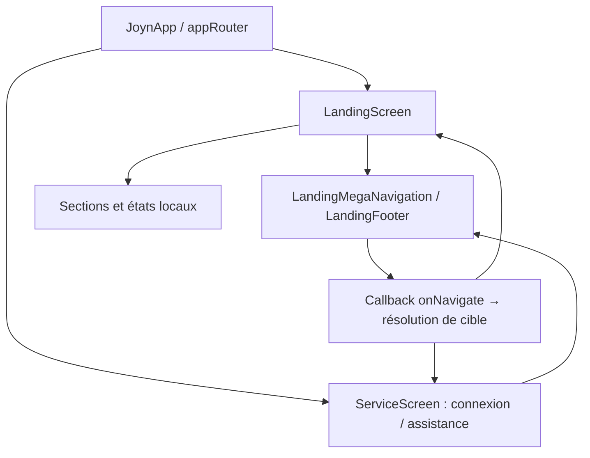

# Landing page JOYN — documentation technique

Interface publique Flutter Web pour les candidats et les recruteurs. Les interactions de démonstration restent locales : aucun CV, candidature, message ou paiement n’est envoyé.

## Architecture et état



`LandingScreen` possède le `ScrollController`, les ancres `GlobalKey`, le chapitre mobile ouvert et les sélections d’acteur. Chaque section conserve ses champs, filtres et favoris dans son propre `State`.
Les contrôleurs, animations, écouteurs et nœuds de focus sont libérés par leur propriétaire dans `dispose`.

## Référence du code

| Emplacement                                            | Responsabilité                                             |
| ------------------------------------------------------ | ---------------------------------------------------------- |
| `lib/main.dart`, `lib/app/app.dart`                    | Initialisation, polices locales et application             |
| `lib/app/routing/app_router.dart`                      | Routes `go_router` et page inconnue                        |
| `lib/design_system/joyn_tokens.dart`, `lib/app/theme/` | Palette, dimensions, durées et thème                       |
| `lib/features/landing/domain/`                         | Groupes de navigation et catalogue des formules            |
| `lib/features/landing/presentation/screens/`           | Assemblage de la landing et pages de service               |
| `lib/features/landing/presentation/sections/`          | Profil, offres, matching, bénéfices, formules et FAQ       |
| `lib/features/landing/presentation/widgets/`           | Navigation, carrousels, chapitres mobiles et illustrations |
| `lib/core/platform/page_metadata*.dart`                | Métadonnées Web et implémentation de remplacement hors Web |
| `web/`, `tool/configure_seo.py`                        | Chargement, guides HTML, manifeste et configuration SEO    |
| `test/widget_test.dart`                                | Tests des composants, interactions et mises en page        |

## Navigation

Routes actives : `/`, `/candidats`, `/entreprises`, `/connexion`, `/assistance`.
`LandingScreen.navigate` distingue les routes, les guides autorisés et les ancres ; sur mobile, il ouvre le chapitre concerné avant `Scrollable.ensureVisible`.
Depuis une page de service, `/?section=cible` retrouve une section ; `?question=…` transmet une question à l’assistance.
Le menu utilise `OverlayPortal` et `CompositedTransformFollower` : panneau sous la barre, ouverture verticale, fermeture différée et retour du focus avec Échap.
Pour ajouter un lien : déclarer sa cible dans `landing_navigation.dart`, son pictogramme dans `symbolFor`, puis sa route ou son ancre dans l’écran concerné.

## Identité visuelle et responsive

Palette, espacements, rayon unique de 16 px et durées : `JoynTokens`. Styles et états des contrôles : thème centralisé. Titres Space Grotesk, corps Inter, polices embarquées.
`LayoutBuilder` adapte les compositions ; les seuils principaux sont mobile `< 600`, tablette `< 1024`, ordinateur `≥ 1024` px. La navbar complète apparaît à 1280 px de vue.
Sur mobile, six chapitres regroupent le contenu. `MobileChapter` combine `Offstage`, `ExcludeFocus` et `TickerMode` pour conserver l’état tout en suspendant le contenu replié.

## Interactions et animations

`NaturalCarousel` utilise un défilement horizontal, un `ScrollController` et une physique d’arrêt par carte. Souris, swipe, défilement horizontal et touches ←/→ sont pris en charge, sans boutons fléchés ni modificateur Maj.
`IntrinsicHeight` et `Row` adaptent la hauteur au contenu complet ; aucune carte ne possède de scroll vertical interne. Éviter un `LayoutBuilder` dans les enfants soumis au calcul intrinsèque.
La carte de formule entière ouvre une feuille récapitulative ; seule cette feuille peut défiler verticalement.
Les animations consultent `MediaQuery.disableAnimationsOf`. Le parcours lié au scroll cède la place au carrousel selon la largeur, la hauteur disponible et la taille du texte.
Les boutons exposent leurs états de focus ; `Semantics` décrit les sélections, panneaux dépliés et résultats dynamiques.

## Formules et abonnements

`subscription_plans.dart` définit les prix en centimes entiers et les prestations. `PlanComparisonSection` sélectionne le catalogue candidat ou entreprise.
Candidat : Basic gratuit, Standard 10,99 €, Plus 19,99 €, Pro 39,99 €/mois. Entreprise : Membre gratuit, Membre premium 100 €/mois.
Le catalogue présente les accès ; il n’applique pas les quotas. Le récapitulatif rejoint `/connexion` sans souscription ni paiement.

## FAQ et assistance

`QuestionsSection` recherche dans les questions et réponses, normalise les accents, filtre par catégorie et affiche cinq résultats par page. Une recherche ou un filtre réinitialise la pagination.
Sans réponse correspondante, un lien transmet la question à `/assistance`. `ServiceScreen` conserve la navbar pour rejoindre les autres rubriques ; aucun formulaire de contact n’est envoyé.

## Web et référencement

`web/index.html` porte les métadonnées initiales, le JSON-LD et les états de chargement/échec. `flutter_bootstrap.js` initialise Flutter et signale les erreurs de démarrage.
`page_metadata_web.dart` utilise des URL sans fragment, actualise le titre et les métadonnées, et applique `noindex,follow` à la connexion. Son import conditionnel préserve la compatibilité hors Web.
Les pages `web/presentation.html` et `web/guides/` fournissent du contenu lisible sans démarrer Flutter. L’hébergement doit rediriger les routes applicatives vers `index.html` en préservant les fichiers statiques.

## Intégration des services

Les sections affichent des données d’exemple ; le profil et les favoris restent en mémoire pendant la visite. La connexion affiche des champs désactivés et un état indisponible.
L’analyse du CV et les recommandations sont expliquées, mais aucun client HTTP n’est implémenté dans la landing. Tout raccordement doit gérer explicitement chargement, résultat vide et erreur.

## Développement et tests

```bash
flutter pub get
flutter run -d chrome
flutter analyze
flutter test test/widget_test.dart
flutter build web --release
```

Utiliser un SDK dont Dart satisfait `pubspec.yaml`. Les tests couvrent notamment la navigation, le focus, la FAQ, les carrousels, les formules et plusieurs largeurs de rendu ; leur exécution reste nécessaire après modification.
