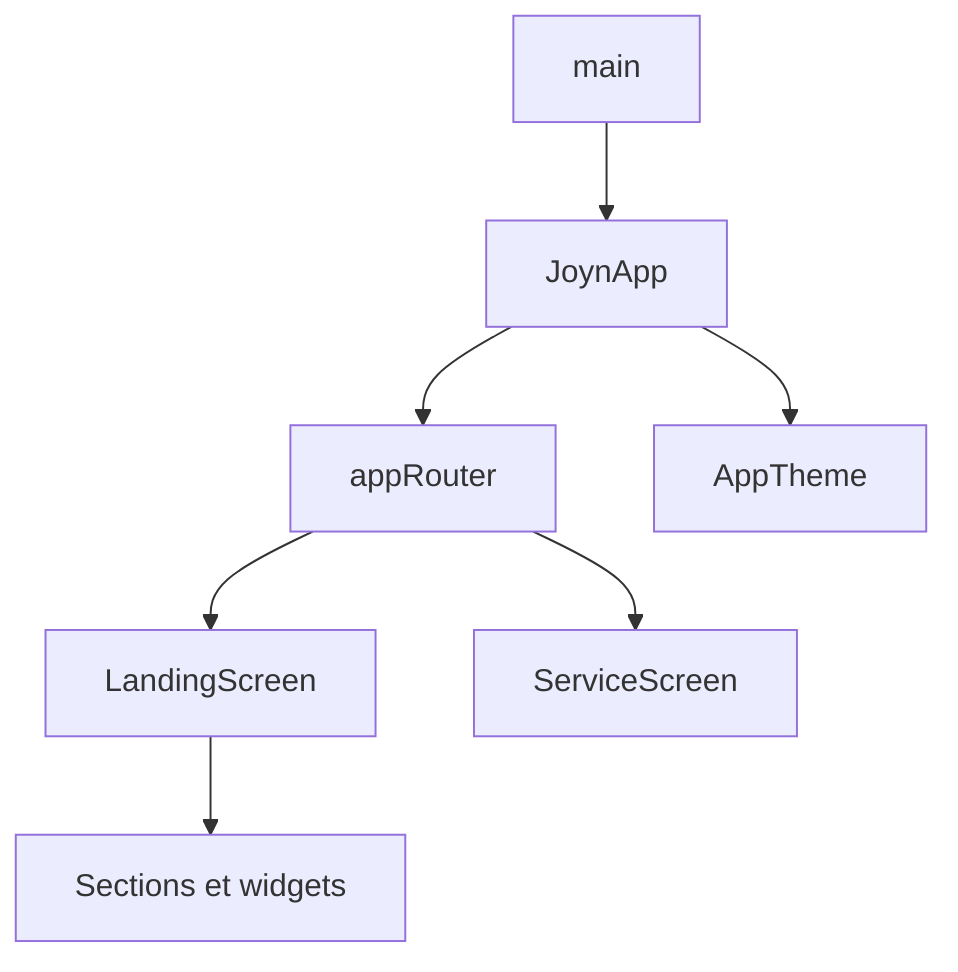

# Architecture

[Sommaire](README.md) · [Référence des fichiers](reference.md)

## Organisation

| Chemin | Responsabilité |
| --- | --- |
| `lib/main.dart` | Initialisation Flutter et lancement de `JoynApp` |
| `lib/app/` | Application, thème et routeur |
| `lib/design_system/joyn_tokens.dart` | Valeurs visuelles communes |
| `lib/core/platform/` | Opérations du navigateur et export conditionnel |
| `lib/core/responsive/` | Helpers de largeur réutilisables |
| `lib/features/landing/domain/` | Définitions des groupes et liens de navigation |
| `lib/features/landing/presentation/screens/` | Assemblage de page et écrans de service |
| `lib/features/landing/presentation/sections/` | Blocs éditoriaux et interactions par usage |
| `lib/features/landing/presentation/widgets/` | Compositions, dessins et commandes réutilisables |
| `web/` | Point d’entrée, chargement, guides et métadonnées statiques |
| `test/widget_test.dart` | Vérification des comportements de la landing |

## Démarrage et responsabilités

`main` initialise Flutter, interdit les téléchargements de polices à l’exécution, configure les URL Web et lance `JoynApp`. `JoynApp` fournit le thème et `appRouter` à `MaterialApp.router`.

`LandingScreen` possède le contrôleur du défilement principal et les clés des sections. Les widgets de navigation ne déplacent pas directement le contenu : ils transmettent une cible par callback. La page décide s’il faut ouvrir une route, un guide HTML ou une section.

## Gestion de l’état

L’état est porté par les `StatefulWidget` concernés. Aucun gestionnaire d’état global n’est utilisé pour les interactions de la landing.

| Propriétaire | État détenu | Durée de vie |
| --- | --- | --- |
| `LandingScreen` | Scroll, ancres, chapitre ouvert, hauteur de navigation | Instance de page |
| `LandingMegaNavigation` | Groupe actif, panneau, recherche, focus et animation | Instance du menu |
| `ProfileSection` | Champs et copie validée de l’aperçu | Instance de section |
| `OpportunitiesSection` | Recherche, filtres et identifiants favoris | Instance de section |
| `QuestionsSection` | Recherche, catégorie, page et réponse ouverte | Instance de section |
| `OrganisationSection` | Rôle sélectionné et détail ouvert | Instance de section |
| `JourneyCarousel` | Contrôleur et page active | Instance de carrousel |

Les contrôleurs et nœuds de focus détenus par un état sont libérés dans `dispose`. `ScrollJourneySection` reçoit le contrôleur du parent : il retire son écouteur mais ne détruit pas ce contrôleur. `didUpdateWidget` déplace l’écouteur si le parent fournit un autre contrôleur.

## Contenus mobiles conservés

`MobileChapter` associe `Offstage`, `ExcludeFocus` et `TickerMode`. Le contenu reste monté lorsqu’il est replié, mais ne participe plus à la navigation clavier et ses animations sont suspendues. Cela conserve les champs et favoris pendant le changement de chapitre.

`MobileReveal` ne suit pas ce modèle : il construit la scène uniquement lorsqu’elle est ouverte. Refermer cette scène détruit son état local ; la rouvrir crée une nouvelle instance.

## Frontière de plateforme

`page_metadata.dart` exporte l’implémentation Web lorsque `dart.library.js_interop` est disponible, et le stub sinon. Le code des sections n’importe pas directement le DOM. Les variantes partagent les mêmes signatures.

`AppRoutes` contient des chemins supplémentaires du projet. Ces constantes ne créent pas des routes : seules les déclarations de `appRouter` définissent les pages disponibles dans cette interface.
